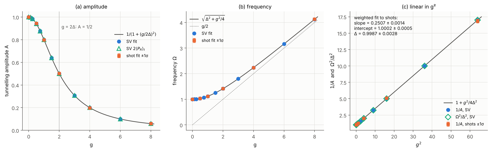
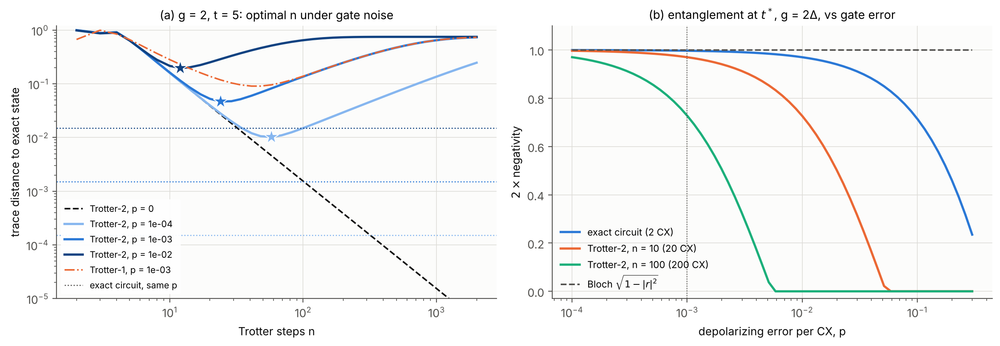

# The Quantum Hopping Particle

A two-qubit Qiskit simulation of a particle tunnelling in a double well while carrying a spin-1/2, with a magnetic-field gradient coupling position and spin:

H = ΔX₀ + (g/2)Z₀Z₁   (q0 = position, q1 = spin)

Built at **Qiskit Fall Fest 2026 × |QET⟩, IIT Hyderabad** (Quantum Information & Computing track).
Team: Qubit_Mahindra

## Results

- **The gradient suppresses tunnelling.** Each spin sees the double well tilted by ±g/2, so tunnelling becomes off-resonant. The amplitude follows A = 1/(1 + (g/2Δ)²) and the frequency Ω = √(Δ² + g²/4). A weighted fit of 2000-shot data gives 1/A vs g² with slope 0.2507 ± 0.0014 (expected 0.25), which recovers Δ = 0.999 ± 0.003.
- **Position and spin get entangled.** The concurrence satisfies C(t) = (g/Δ)·P_R(t) and reaches 1 at g = 2Δ. Z-basis measurements show no correlation at all; the entanglement only appears in mixed-basis correlators and in tomography.
- **Validation.** We use an exact 2-CNOT circuit (it follows from conservation of Z₁), `expm` and Trotter-1/2 side by side.
  - Convergence orders are as expected (infidelity ∝ dt² and dt⁴).
  - A χ² test separates Trotter error from shot noise.
- **Gate noise.** With 10⁻³ depolarizing error per CNOT:
  - more Trotter steps stop helping beyond n ≈ 24;
  - the exact 2-CNOT circuit keeps the entanglement, while a 200-CNOT Trotter circuit loses most of it.




## Run it

```bash
pip install -r requirements.txt
jupyter notebook quantum_hopping_particle.ipynb   # Kernel → Restart & Run All (~1 min)
```

Tested with Python 3.13 and Qiskit 2.5.2. Every run regenerates `figures/` and `data/`. Seeds are fixed, so the data files reproduce exactly.

## Repository layout

| Path | Contents |
|---|---|
| `quantum_hopping_particle.ipynb` | full implementation and analysis (executed, with outputs) |
| `figures/` | F1–F10 as PNG and PDF, captions in `figures/CAPTIONS.md` |
| `data/` | numbers behind every figure; `summary.json` (key results), `manifest.json` (versions, seeds, SHA-256 hashes) |

| Figure | Content | Simulator |
|---|---|---|
| F1 | baseline, g = 0 | Statevector, shots |
| F2–F3 | P_R(t) vs g; amplitude and frequency, linear law in g² | Statevector, shots |
| F4–F5 | Trotter convergence; g-sweep repeated with Trotter-2 | Statevector |
| F6–F7 | spin Bloch vector, concurrence, correlators | Statevector |
| F8 | entanglement from 9-setting tomography, with a dephased-spin control | shots |
| F9 | optimal Trotter step and entanglement under gate noise | density matrix |
| F10 | initial spin state and Δ ≠ 1 robustness checks | Statevector |
